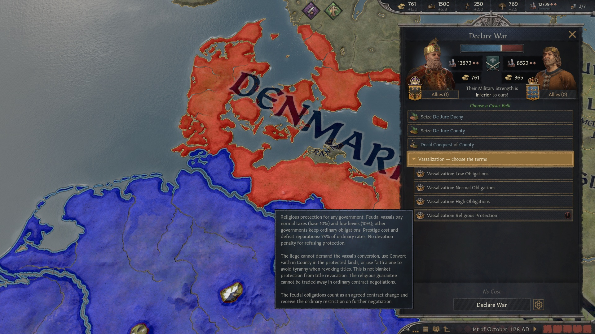
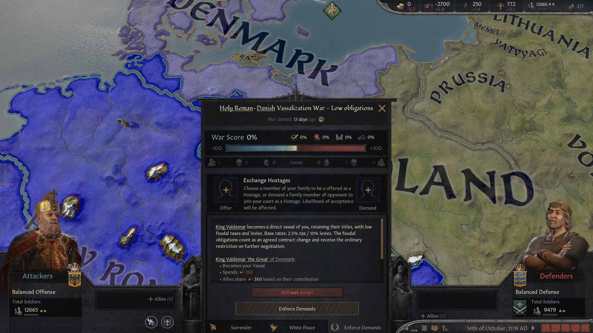
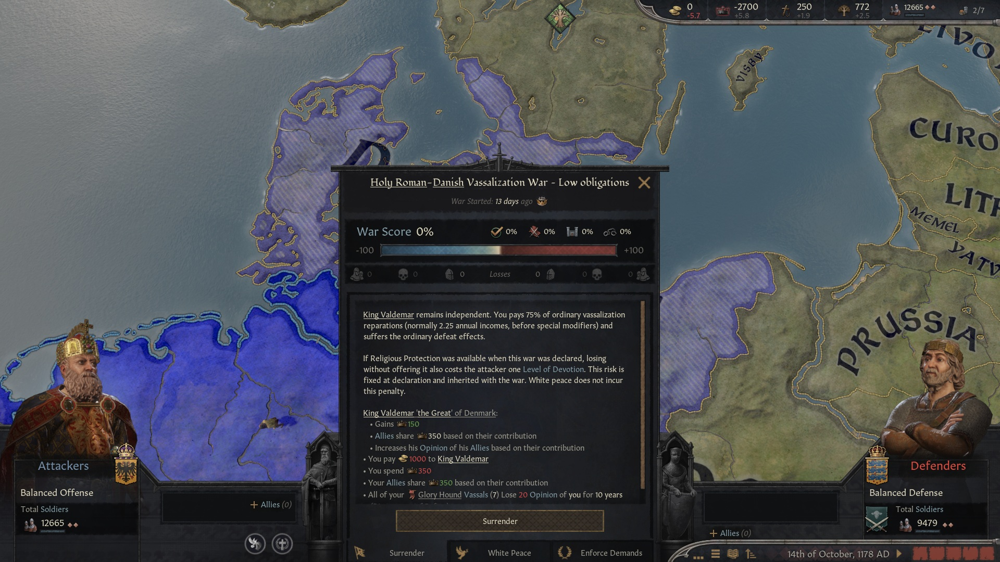
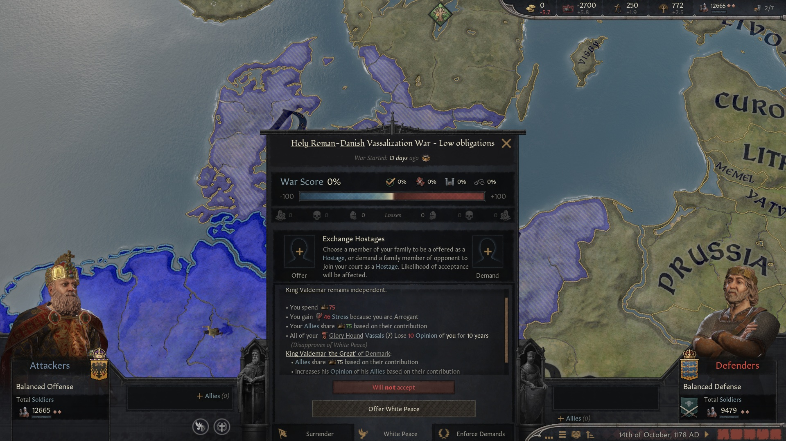

# Vassalization Extended

## At a glance

- 🟢 **Version 0.2.4** · Targets CK3 **1.21.0.3**.
- 🟢 **Standalone:** no other mod required.
- 🟢 **Forced Vassalization has no target county limit.**
- 🟢 **Four peace terms in one expandable Vassalization group.**
- 🟢 **Languages:** English, French, German, Japanese, Korean, Polish, Russian, Simplified Chinese and Spanish.
- 🔴 Affects **players and AI**; other war requirements still apply.
- 🔴 Conflicts with replacements of the Forced Vassalization CB, Declare War window or subject contract groups.
- 🔴 Refusing available religious protection risks **one level of devotion** if the attacker loses.

## A kingdom can bend the knee

Vassalize a neighbor without a county ceiling; choose obligations and religious rights before war.

## Choose the terms of submission

Removes the **Forced Vassalization** county limit; keeps the existing casus belli.

Target a lower-rank independent neighbor. Florin's Guelph/Ghibelline, merchant and republic war rules apply.

| Terms | Feudal taxes / levies, before modifiers | Prestige cost | Defeat reparations |
| --- | --- | --- | --- |
| Low obligations | 2.5% / 10% | 75% of ordinary | 75% of ordinary |
| Normal obligations | 10% / 25% | Ordinary | Ordinary |
| High obligations | 15% / 35% | 150% of ordinary | 150% of ordinary |
| Religious protection | 10% / 10%, with protection | 75% of ordinary | 75% of ordinary |

Non-feudal targets offer **Normal Obligations** and **Religious Protection**, keeping their government's ordinary financial and military obligations. Protection adds religious rights; its option stays visible but cannot start war unless vanilla protection conditions are met.

Terms modify prestige cost after target-county/title-rank scaling. Ordinary defeat reparations normally use three annual attacker incomes; special income and cultural rules apply. Religious piety costs and other victory, white-peace and defeat effects remain vanilla.

Victory makes the defeated ruler a direct vassal, retaining their titles. Chosen feudal obligations count as an agreed contract change, normally restricting renegotiation. Low/high-obligation wars invalidate if the target stops being feudal.

## Religious protection and the cost of refusing it

Protection blocks vassal conversion demands, Convert Faith in County in protected lands, and faith-only revocation tyranny exemptions. It does **not** block every revocation. It survives faith changes; ordinary contract negotiation cannot remove it.

Eligibility uses vanilla's religious-protection checkbox: different faiths, the Jizya/nonbeliever-tax restriction and its existing-contract exception, checked at war declaration. If protection was available but another vassalization option was chosen, **attacker defeat costs one level of devotion**, in addition to normal consequences. The war inherits this risk; faith changes do not recalculate it. White peace has no extra penalty.

Peaceful **Offer Vassalization** and **Swear Fealty** conditions and acceptance stay unchanged.

## Getting started

1. Enable **Vassalization Extended** in your launcher playset.
2. Obtain access to Forced Vassalization and choose a neighboring independent ruler of lower rank.
3. Open **Declare War**, expand **Vassalization — choose the terms**, and select a profile.
4. Read the tooltip, victory/defeat preview and price before war.

## Compatibility and load order

Replaces `common/casus_belli_types/00_vassalization.txt`, `gui/interaction_declare_war.gui` and `common/subject_contracts/groups/subject_contract_groups.txt`. Adds a religious peace obligation to the vanilla vassal contract groups and overrides the Forced Vassalization concept description in all nine CK3 languages. Other mods changing these files, groups or descriptions need a compatibility review; load order alone cannot merge their changes.

No total-conversion compatibility is claimed. No new DLC; vanilla unlock requirements remain.

## Saves and known limits

Adds three CB IDs, war variables and a contract obligation. **Keep the mod enabled for campaigns using these wars or protected contracts.** Removal or downgrade in such campaigns is unsupported. Back up saves before installing/updating.

Existing original-CB wars retain their resolution without the new devotion penalty. Religious peace follows Florin's native obligations. Total-conversion governments with custom contract groups need a religious-protection adapter.

Diplomatic acceptance is unchanged. AI can choose new profiles by personality; the scripted Conqueror forced-war route still uses ordinary vassalization. Some vanilla memory/war-message classifications recognize only the original CB, giving new variants generic text.

## Feedback and support

Report CK3 version, mods/load order, ruler ranks, target size, unlock route and screenshot of the blocked CB or error.

[Report an issue on GitHub](https://github.com/G4VV4KH/-CK3-Vassalization-Extended/issues)

Email: g4vv4kh@gmail.com

### [Want to support my work? Donate on Ko-fi 💛](https://ko-fi.com/g4vv4kh)

## Find this mod elsewhere

- [Steam Workshop](https://steamcommunity.com/sharedfiles/filedetails/?id=3813943691)
- [Paradox Mods](https://mods.paradoxplaza.com/mods/162059/Any)
- [Nexus Mods](https://www.nexusmods.com/crusaderkings3/mods/407)
- [GitHub](https://github.com/G4VV4KH/-CK3-Vassalization-Extended)

## My other mods

### Standalone mods

- [Parley: The Negotiating Table](https://steamcommunity.com/sharedfiles/filedetails/?id=3811090081) — negotiate diplomatic agreements.
- [Marriage Calculation Assistant](https://steamcommunity.com/sharedfiles/filedetails/?id=3811100163) — compare and sort marriage candidates.
- [Your Own Hegemony](https://steamcommunity.com/sharedfiles/filedetails/?id=3811201582) — found a custom hegemony.
- [Court Automation](https://steamcommunity.com/sharedfiles/filedetails/?id=3814028714) — automate court positions and recruit courtiers or knights.
- [Nomad Autorefill](https://steamcommunity.com/sharedfiles/filedetails/?id=3814793283) — automatically reinforce nomadic Men-at-Arms using herd or gold.
- [Tax Collection Automation](https://steamcommunity.com/sharedfiles/filedetails/?id=3815381275) — automatically assign tax collectors and optimize tax jurisdictions.
- [Council Assignment Automation](https://steamcommunity.com/sharedfiles/filedetails/?id=3815689627) — automate council appointments and optimize councillor assignments.
- [Strategist Assistant](https://steamcommunity.com/sharedfiles/filedetails/?id=3827659479) — plan armies, recruitment and wars.
- [Title Domination](https://steamcommunity.com/sharedfiles/filedetails/?id=3828276945) — proclaim uncreated titles through diplomacy and war.
- [Accolade Workshop](https://steamcommunity.com/sharedfiles/filedetails/?id=3836819350) — choose accolade attributes or knights first and set rank limits.

### Compatibility patches

- [[compatch] CAA + CA](https://steamcommunity.com/sharedfiles/filedetails/?id=3816373375) — use Council Assignment Automation and Council Autopilot together.

## Credits

Cover artwork was generated with AI. Gallery images are authentic Crusader Kings III screenshots.

## Screenshots

